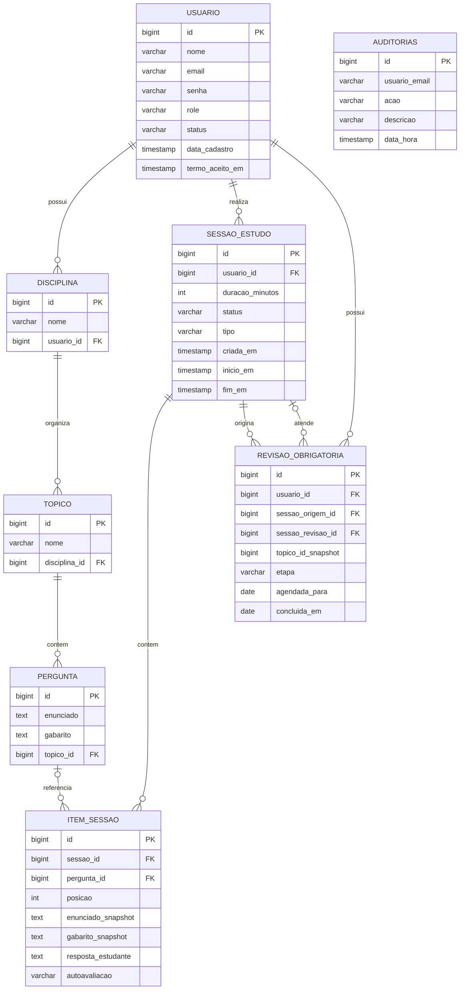

# Ritmo

Ritmo é uma aplicação web para organizar disciplinas e tópicos e realizar sessões curtas de estudo ativo, com perguntas, autoavaliação e agenda de revisões. A aplicação usa Java 21, Spring Boot, Spring MVC, Thymeleaf, Spring Security e PostgreSQL.

## Arquitetura e persistência

O backend segue o padrão MVC organizado em camadas de apresentação (controllers e templates Thymeleaf), negócio (services e DTOs) e persistência (entidades JPA e repositórios Spring Data). O banco é PostgreSQL; o Flyway controla as alterações do schema e o Hibernate valida o mapeamento, sem atualizar o schema automaticamente.

O diagrama abaixo representa as tabelas criadas pelas migrations:



As sessões duram 5, 15 ou 30 minutos. Se uma tentativa for interrompida ou expirar, ela retorna a pendente e as respostas daquela tentativa são descartadas. O dashboard apresenta a soma das durações configuradas nas sessões concluídas como **minutos planejados**, não como medição do tempo efetivamente estudado. As autoavaliações são percepções declaradas pelo estudante, não uma correção automática das respostas.

O cadastro registra o aceite dos termos e políticas. Senhas são armazenadas com BCrypt e as operações de conteúdo são limitadas aos dados do usuário autenticado. Registros de auditoria anteriores a seis meses são removidos diariamente às 03:00, conforme o fuso horário do servidor. A adequação desse prazo à política institucional e às obrigações legais deve ser confirmada pelo responsável pelo tratamento.

## Pré-requisitos

- JDK 21
- Docker Desktop com Docker Compose, para o PostgreSQL local persistente

## Configuração e execução local (Windows PowerShell)

1. Copie `.env.example` para `.env` e substitua `DEV_DB_PASSWORD` e `APP_ADMIN_DEV_SENHA` por valores fortes locais. O arquivo `.env` é ignorado pelo Git.
2. Inicie o banco:

   ```powershell
   docker compose up -d postgres
   ```

   O Compose mantém os dados no volume nomeado `ritmo-postgres-data`, que sobrevive a reinicializações e à recriação do container.

3. Carregue as variáveis do arquivo `.env` no processo do PowerShell e execute a aplicação:

   ```powershell
   Get-Content .env | ForEach-Object {
       if ($_ -match '^([^#=]+)=(.*)$') {
           [Environment]::SetEnvironmentVariable($matches[1], $matches[2], 'Process')
       }
   }
   .\mvnw.cmd spring-boot:run
   ```

   O perfil padrão é `dev`. No primeiro início, o Flyway cria/valida o schema e a aplicação cria a conta administrativa configurada por `APP_ADMIN_EMAIL`, `APP_ADMIN_NOME` e `APP_ADMIN_DEV_SENHA`, caso ela ainda não exista. Alterar a senha no `.env` não redefine uma conta já criada.

   **Para executar pelo IntelliJ IDEA**, o arquivo `.env` não é carregado automaticamente. Em **Run → Edit Configurations → Environment variables**, adicione `DEV_DB_URL`, `DEV_DB_USERNAME`, `DEV_DB_PASSWORD` e `APP_ADMIN_DEV_SENHA` com os valores do seu `.env` (e, opcionalmente, `APP_ADMIN_EMAIL`, `APP_ADMIN_NOME` e `DEEPL_AUTH_KEY`). Reinicie a aplicação após salvar a configuração.

4. Abra `http://localhost:8080`, cadastre uma conta de estudante e percorra o fluxo: disciplina → tópico → perguntas → bloco de estudo → respostas e autoavaliação → revisões e dashboard.

`DEEPL_AUTH_KEY` é opcional; se não for configurada ou a integração externa falhar, a aplicação usa suas frases locais. Não use dados pessoais reais na demonstração.

## Testes

Os testes que carregam a aplicação ou acessam o banco precisam do PostgreSQL ativo e das variáveis de ambiente da configuração de desenvolvimento:

```powershell
.\mvnw.cmd clean test '-Dtest=*Test,!*IntegrationTest,!RitmoApplicationTests'
```

O comando acima executa os testes unitários com nome terminado em `Test`, sem iniciar os testes de integração e de contexto que exigem PostgreSQL.

O relatório JaCoCo é gerado em `target\site\jacoco\index.html`. Confira a coluna **Coverage** do projeto e de cada classe relevante; o percentual é cobertura de linhas de código, não quantidade de testes. O build exige no mínimo 52% de cobertura de linhas no projeto. Para executar também os testes de integração, configure o PostgreSQL e as variáveis de ambiente e rode `.\mvnw.cmd clean verify`. A execução da suíte não substitui uma avaliação de usabilidade nem comprova eficácia educacional.

## Perfil de produção

Ative explicitamente `SPRING_PROFILES_ACTIVE=prod` e configure `PROD_DATASOURCE_URL`, `PROD_DATASOURCE_USERNAME`, `PROD_DATASOURCE_PASSWORD` e `APP_ADMIN_PROD_SENHA` no ambiente de implantação. O perfil de produção valida o schema por Hibernate e usa as migrations Flyway; os segredos não devem ser incluídos no repositório.
